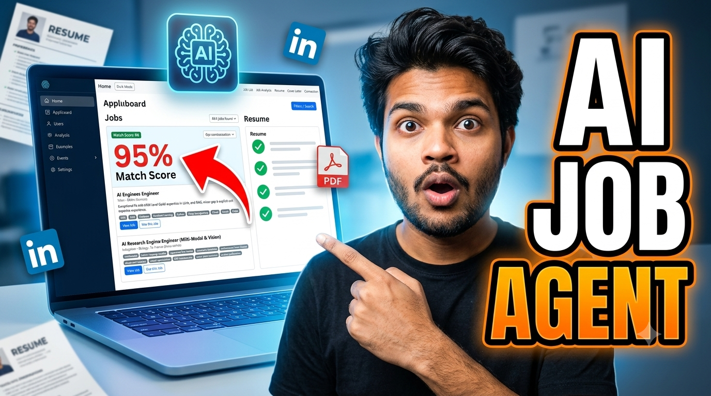
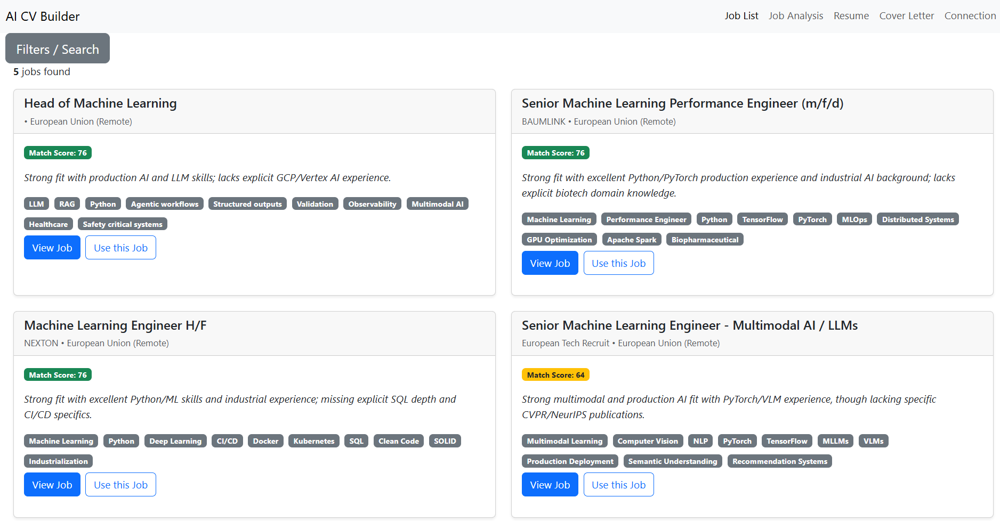
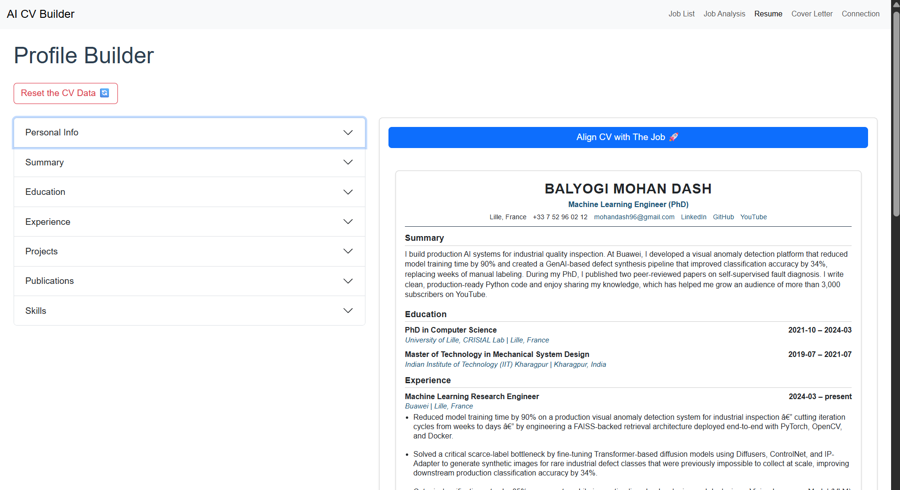
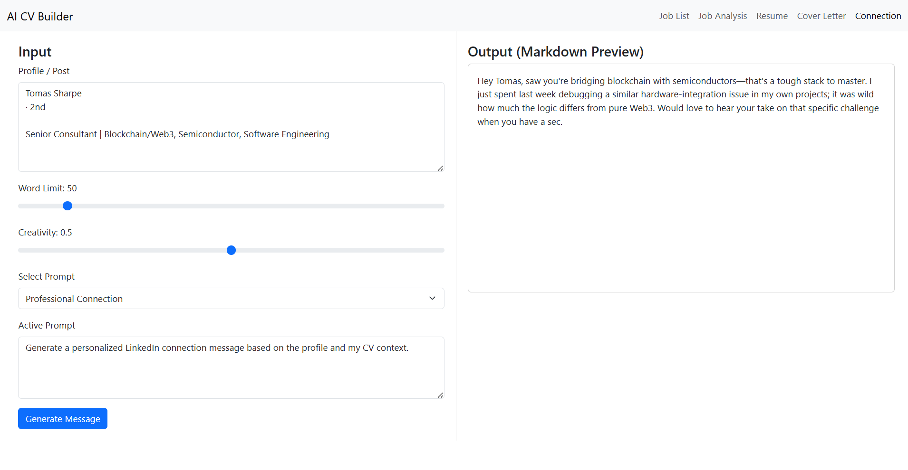
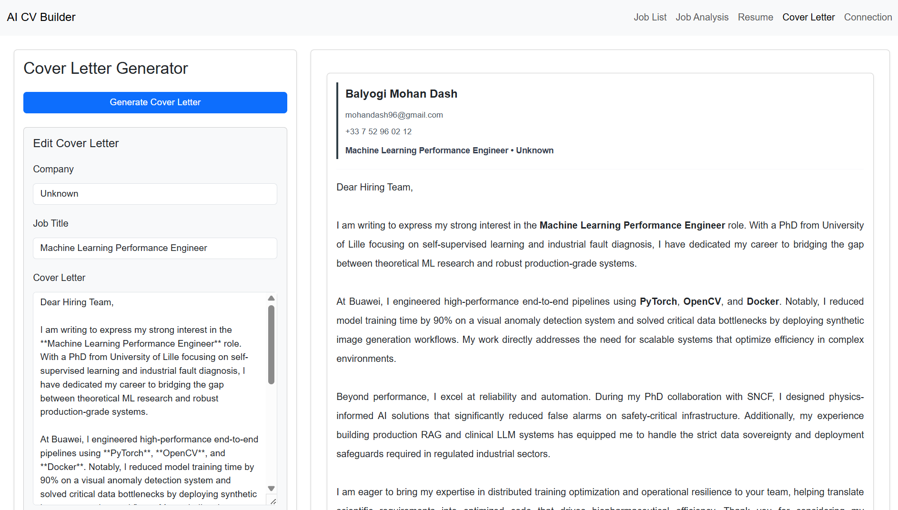
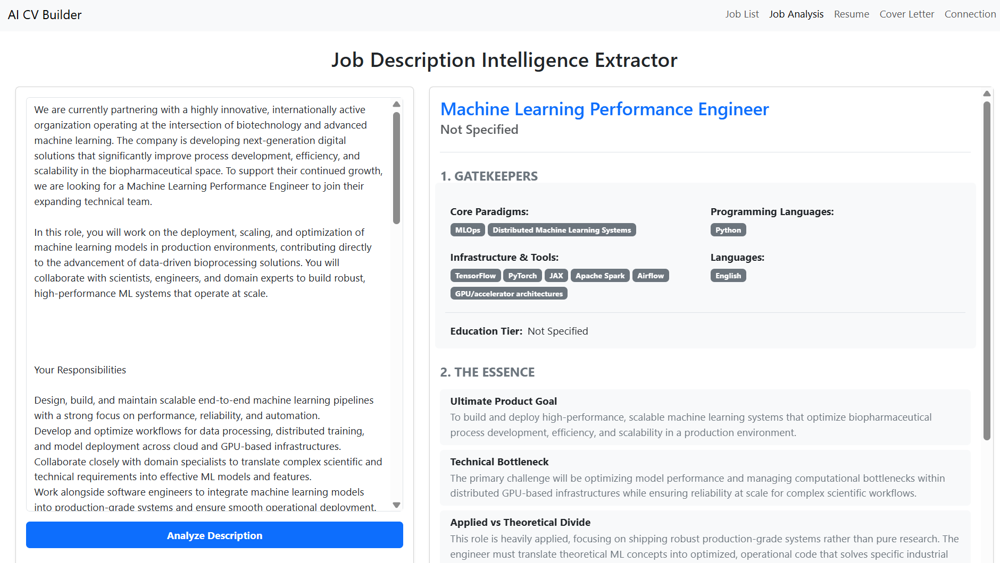

# AI CV Customization & Job Automation System

<table>
  <tr>
    <td>
      
    </td>
    <td style="vertical-align: middle; padding-left: 20px;">
      <a href="https://youtu.be/1VJQv0_gJNE" target="_blank">
        ▶ Watch on YouTube
      </a>
    </td>
  </tr>
</table>

This repository contains a full-stack application for tailoring CVs with AI, analyzing job descriptions, generating cover letters and connection messages, and automating LinkedIn job workflows.

It currently includes:

- A FastAPI backend for CV editing, PDF rendering, job analysis, and browser automation
- A React + Vite frontend for editing resumes, reviewing job matches, and generating content
- Playwright-based LinkedIn automation
- Local LLM inference through Ollama (Qwen 3.5)
- SQLite-backed storage for jobs and LLM evaluation data

---

# Tech Stack

### Backend

- FastAPI (Python) – API layer and request handling
- SQLite – Lightweight database for jobs and evaluation data
- Playwright – Browser automation for LinkedIn workflows
- Pydantic – Validation and schema enforcement

### Frontend

- React – Component-based UI development
- Bootstrap – Styling and responsive layout
- Vite – Frontend build and dev server

### AI / LLM Layer

- Ollama – Local LLM runtime
- Qwen 3.5 – Local inference model for CV and cover-letter generation

### Infrastructure & Tooling

- UV – Python dependency and environment management
- Node.js + npm – Frontend package management
- Pytest – Backend test suite

---

# Table of Contents

- [Feature Showcase](#feature-showcase)
- [Project Structure](#project-structure)
- [Architecture Diagram](#architecture-diagram)
- [Setup](#setup)
- [Ollama Setup](#ollama-setup)
- [Running the App](#running-the-app)
- [Testing](#testing)
- [Additional Information](#additional-information)

---

# Feature Showcase

### Job Listings View

<p align="center">
  
</p>

---

### Resume Builder

<p align="center">
  
</p>

---

### Connection Message Writer

<p align="center">
  
</p>

---

### Cover Letter Generator

<p align="center">
  
</p>

---

### Job Analysis Dashboard

<p align="center">
  
</p>

---

# Project Structure

```
AI_CV_Customization/
├── cv_editing_react_app/
│   ├── backend/
│   │   ├── api/                      # FastAPI routes and app entrypoint
│   │   ├── schema/                   # Request/response validation schemas
│   │   ├── services/                 # Business logic, LLM integration, PDF rendering, Playwright automation
│   │   │   ├── browser_automation_playwright/
│   │   │   ├── database/
│   │   │   └── llm.py
│   │   └── test/                     # Backend tests
│   └── frontend/my-app/              # React + Vite frontend app
│       ├── src/                      # React components and pages
│       ├── public/                   # Static assets and HTML templates
│       └── package.json              # Frontend dependencies and scripts
├── job_listings/                      # Saved job listings data
├── package.json                       # Root scripts for running backend/frontend together
├── pyproject.toml                     # Python dependencies and project config
└── assets/                            # Project screenshots and media
```

The app is now organized under the cv_editing_react_app directory, with the backend and frontend split into separate subprojects.

---

# Architecture Diagram

Even a simple text diagram helps:

```text
Frontend (React)
      ↓
FastAPI Backend
      ↓
Playwright Automation → LinkedIn
      ↓
Database (SQLite)
      ↓
Ollama (Local LLM)
```

# Setup

## 1. Clone the Repository

```bash
git clone git@github.com:mohan696matlab/AI_CV_Customization.git
cd AI_CV_Customization
```

---

## 2. Install UV and Python Dependencies

If you do not already have UV installed:

```bash
pip install uv
```

Verify the installation:

```bash
uv --version
```

Install the project dependencies and create the virtual environment from the repository root:

```bash
uv sync
```

---

## 3. Install Playwright Browser Binaries

Playwright is used for LinkedIn automation. Install the browser binaries with:

```bash
uv run --directory cv_editing_react_app/backend playwright install
```

---

## 4. Configure LinkedIn Credentials

Create a `.env` file inside the backend directory:

```text
cv_editing_react_app/backend/.env
```

Add your LinkedIn credentials:

```ini
username=your_username
password=your_password
```

Example:

```ini
username=john.doe@gmail.com
password=my_password
```

---

## 5. Initialize the Database

Run the database bootstrap from the repository root or from the backend directory:

```bash
uv run --directory cv_editing_react_app/backend python -m services.database.db
```

To reset the database and recreate its tables:

```bash
uv run --directory cv_editing_react_app/backend python -m services.database.db --reset
```

---

## 6. Start the Backend Server

You can start the backend from the repository root with the helper script:

```bash
npm run backend
```

Or start it directly:

```bash
uv run --directory cv_editing_react_app/backend uvicorn api.server:app --reload --port 8000
```

The API will be available at:

- Application: http://localhost:8000
- Swagger UI: http://localhost:8000/docs
- ReDoc: http://localhost:8000/redoc

---

# Ollama Setup

Ollama is used for local LLM inference.

## 1. Install Ollama

Download and install Ollama from:

https://ollama.com/download

Verify the installation:

```bash
ollama --version
```

## 2. Pull a Model

```bash
ollama pull qwen3.5:9b
```

## 3. Adjust the Model Settings

The backend currently reads its model configuration from the LLM service file at cv_editing_react_app/backend/services/llm.py. Update the values there if needed:

```python
MODEL_NAME = "qwen3.5:9b"
HOST_ADDRESS = "http://localhost:11434"
```

## 4. Remove a Model (Optional)

```bash
ollama rm qwen3.5:9b
```

---

# Running the App

## Frontend

Make sure Node.js and npm are installed:

```bash
node -v
npm -v
```

From the repository root, start the frontend with:

```bash
npm run frontend
```

You can also start it directly from the frontend folder:

```bash
cd cv_editing_react_app/frontend/my-app
npm ci
npm run dev
```

## Full Stack

From the repository root, run both services together:

```bash
npm run dev
```

The frontend will be available at:

- Application: http://localhost:5173/

The backend will be available at:

- Application: http://localhost:8000
- Swagger UI: http://localhost:8000/docs
- ReDoc: http://localhost:8000/redoc

---

# Testing

Run the backend test suite from the repository root:

```bash
uv run pytest -q
```

---

# Docker

Docker Compose runs the React frontend behind Nginx and the FastAPI backend as separate services. SQLite, generated PDFs, and exported job listings are stored in named volumes.

Rotate any credentials that have previously been committed or shared, then create a local Docker env file:

```powershell
Copy-Item .env.example .env
```

Fill in `GEMINI_API_KEY` and `APIFY_API_KEY`. For LinkedIn automation, also fill in `LINKEDIN_USERNAME` and `LINKEDIN_PASSWORD`.

Build and start the default Gemini-backed stack:

```bash
docker compose up --build
```

Open the application at http://localhost:8080. The backend API and Swagger UI are available through http://localhost:8080/api/docs.

To use the optional Ollama container, set `MODEL_NAME` to the model you pulled and start the profile:

```bash
docker compose --profile ollama up --build
docker compose --profile ollama exec ollama ollama pull qwen3.5:9b
```

Stop the services with `Ctrl+C`, or use `docker compose down`. Do not add `-v` unless you intentionally want to delete the persisted SQLite database and generated files.

---

# Useful Commands

### Reinstall Project Dependencies

```bash
uv sync
```

### Update Dependencies

```bash
uv lock --upgrade
uv sync
```

### Install Playwright Browser Binaries

```bash
uv run --directory cv_editing_react_app/backend playwright install
```

### Start the Backend Server

```bash
npm run backend
```

### Run the Frontend

```bash
npm run frontend
```

### Run the Full Stack

```bash
npm run dev
```

---

# Additional Information

## 1. Save LinkedIn Login Cookies (One-Time Setup)

This saves your LinkedIn login session so you do not need to authenticate every time.

```bash
uv run --directory cv_editing_react_app/backend python -m services.browser_automation_playwright.save_login_cookies
```

## 2. Scrape LinkedIn Job Listings (Optional)

```bash
uv run --directory cv_editing_react_app/backend python -m services.browser_automation_playwright.browser_automation
```

## 3. Database Management

### Remove All Job Records (Keep Database)

```bash
uv run --directory cv_editing_react_app/backend python -c "from services.database.db import delete_all_jobs; delete_all_jobs()"
```

### Remove the Database File Entirely

```bash
uv run --directory cv_editing_react_app/backend python -c "from services.database.db import remove_db; remove_db()"
```

---
